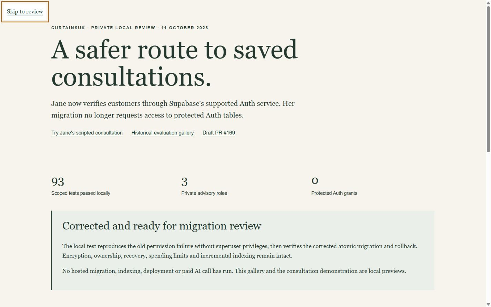

# Jane migration permission fix: implementation evidence

11 October 2026. Continued from `6d0890ab782d274ce5a0e82cac71494004f7eb18` on `feat/jane-consultation-phase2-20261009`, draft [PR #169](https://github.com/Nylon1/CurtainsUK/pull/169).

## Outcome

The proposed Auth grant could not be delegated by hosted `postgres`. The corrected migration has no protected Auth access. Server-side Supabase `getUser(jwt)` plus verified `getClaims(jwt)` replace direct session-table reads. Jane's private ownership boundary, encryption, recovery, retention, locks, accounting and incremental indexing remain intact. The approved profile is unchanged.

- [Exact migration/permission/rollback approval manifest](MIGRATION_REVIEW.md).
- [Current readiness and hosted-test limits](../../docs/specialist-advisory/JANE_AUTH_MIGRATION_FIX.md).
- [Exact changed files for this increment](CHANGED_FILES.txt), relative to the starting commit above.
- [Canonical SQL and source hashes](migration-bundle.json), [complete object inventory](migration-objects.json).
- [Working local review](http://127.0.0.1:8789/auth-fix), [scripted consultation](http://127.0.0.1:8789/). Start with `node scripts/jane-preview.mjs` if stopped. This uses the existing local encrypted mock store, not hosted Auth or a real model.

## Tests

| Scope | Passed |
| --- | ---: |
| Consultation, contracts, mock evaluation and hosted configuration | 34 |
| Cloud persistence, workers, rates, principal and protected HTTP | 5 |
| Actual Supabase SDK with real JWT signatures and synthetic HTTP | 4 |
| Descriptive search, index worker, foundations, RLS, separate processes | 7 |
| Complete identity paging, source integrity and population resource guards | 4 |
| Exact migration under non-superuser, original failure and rollback | 1 |
| Phase 1 profiles and interaction regression | 20 |
| Shopify theme contracts | 18 |
| **Total** | **93** |

[All test exit codes and logs](tests.json). Scoped ESLint passed with no diagnostics: [receipt](lint.log). Tests run serially using existing dependencies; no large build or dependency installation.

The migration test reproduces the original failing grant under a role with CREATEROLE but no Auth grant option. The corrected SQL then succeeds. Late-failure rollback, name-collision refusal, new-role privilege boundaries, preserved Auth ownership/ACLs and preserved synthetic Master rows pass. Local creation took about 89 ms with 280 KiB initial relation/index size. Hosted version differs and is not certified by this local result.

The authentication tests reject revoked/deleted sessions despite valid signatures, wrong issuer/audience/role/owner, anonymous users, expired/not-yet-valid tokens, malformed session IDs, forged signatures, excessive payloads, redirects and unavailable Auth. Failure prevents advisory/model access. Raw transport errors are not logged by the SDK. No real Auth user or API credential is used.

Separate Node processes share a local PGlite database through the private runtime role: simultaneous contention, replay, encrypted storage, foreign-owner denial, process restart, one-use recovery and distributed rate/expiry controls pass. See [concurrency receipt](multi-instance.json) and [index performance receipt](index-performance.json). This is not a hosted connection-pool or two-server deployment test.

The new review gallery passed Chrome layout checks at 320, 390, 412, 768 and 1440 px with no overflow. Enter opens the exact-migration disclosure. The existing consultation link and updated review link work. [Browser checks](browser-checks.json). Physical iPhone and spoken screen-reader verification remain pending; prior reduced-motion evidence is preserved, not rerun for this backend-only correction.

## Read-only hosted and backup observations

[Project, permissions, database and migration history](hosted-preflight.json): existing project ACTIVE_HEALTHY, Pro, PostgreSQL 17.6.1.166, 692,268,179 bytes, 16 connections against 60, no lock waiters. Seventy-eight migration records; latest `20261004064841 browse_twice_daily_low_io`. No advisory schema/roles or Jane migration exists.

[Dashboard capacity](resource-dashboard.txt): last 24 hours CPU 6%, I/O 1%, memory 64%, disk 50%, peak connections 10/60, 948 slow queries, 0.74% database errors. Aggregates are not live indexing clearance. [Backup dashboard](backup-dashboard.txt): physical daily backup 11 October 01:03:26 UTC, Restore available. Restore not rehearsed. Toshiba PID 20836 disappeared during work, without a successful completion receipt. C: approximately 40.16 GiB free. No backup, evidence or worktree was deleted or changed.

## Release boundary and costs

Protected HEAD `3649c879a4a5ddf88c2093a4172d20fbc58cd265` and independent PR #167 `851078c674ac2e9231e51dffbd5949ed4ea7c6d1` remain unchanged. No edits to production Naila, Fabric Intelligence, Master records, visualiser, homepage, pricing, stock, checkout or Shopify theme files. No production migration, index population, deployment, merge, public activation, new Supabase project/branch or paid model call.

Existing indexing identity denominator remains 16,883; hosted descriptive coverage remains 0. This change does not reread or rebuild the catalogue. No new service or charge was incurred. Prior model receipts remain US$0.132574. Fresh paid evaluation and old-key revocation remain pending.

**Next approval:** the exact corrected migration checksum in the manifest, on the existing project, subject to fresh protected-source/history/backup/resource checks. Hosted synthetic Auth/pooler/concurrency verification follows under separate approved credentials and deployment protection. Preserve all historical evidence; the older Auth-grant proposal is superseded and must not be executed.
