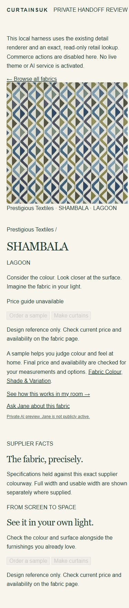
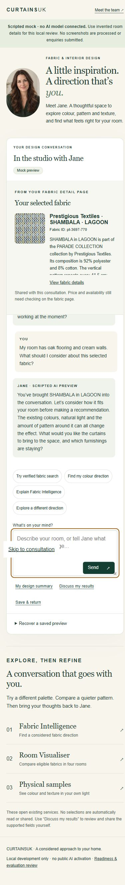
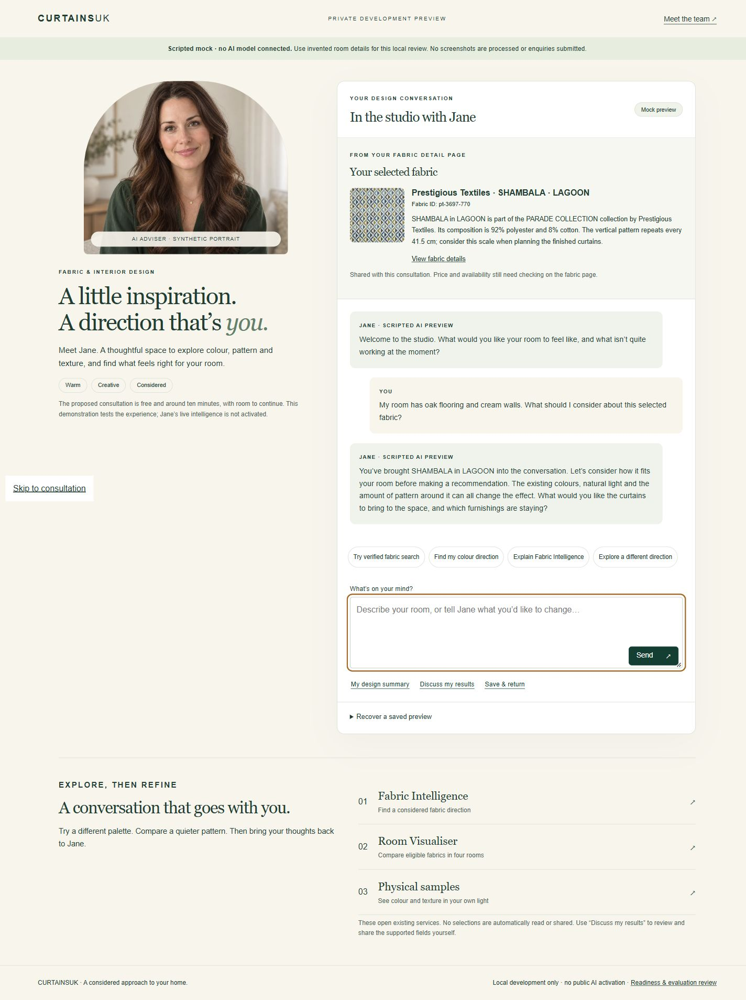
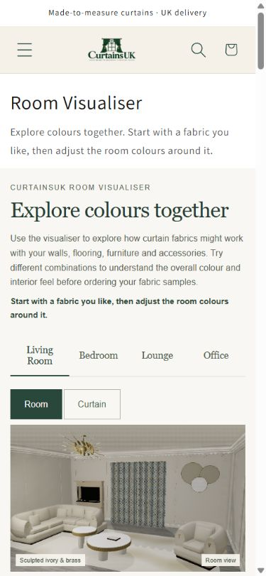

# Jane review evidence, 13 October 2026

This is local/private review evidence plus bounded read-only population verification, not launch approval.

- [Readiness report and exact blockers](../../docs/specialist-advisory/JANE_REVIEW_GATES_20261013.md)
- [Population/catch-up gate result](review-gates.json): 11,517/11,517; catch-up blocked; zero descriptive-search or paid calls
- [Fresh hosted readback used for that gate](gate-hosted-readback.json); [earlier readback retained](hosted-readback.json)
- [Historical real-answer audit](answer-audit.json)
- [20-scenario human review pack](human-review.html), [40 unfilled scorecards](human-scorecards.json)
- [Actual browser measurements and limitations](browser-evidence.json)
- [Indexer preservation](indexer-preservation.json)
- [Focused test record](tests.json)

## Actual Chrome responsive captures

`chrome-resumed-state.txt` records the resumed mock conversation and exact ID. `jane-shared-state.txt` records the earlier private in-app-browser check. `room-visualiser-state.txt` records the actual selected SHAMBALA / LAGOON fabric and same-ID links.

`iab-override-attempt-390-actual-1280.png` and `iab-override-attempt-1440-actual-1280.png` preserve unsuccessful viewport override attempts. Their actual width was 1280 px, so they do not count as mobile or 1440 px passes. The Chrome measurements are separate successful runs.

No physical iPhone, spoken screen-reader or actual background-tab test passed in this run. Reduced motion and touch are not newly verified here. Previous 12 October browser-emulation evidence remains separate.
