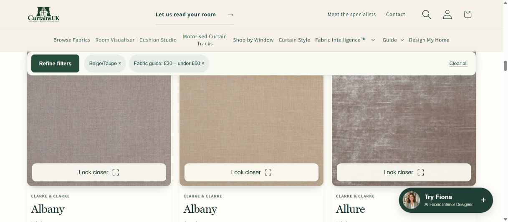

# Fabric detail curtain demo review and publication

Base: protected `release/production` at `00c50ef2d3ad56f48e577f692ab04f43f8a0d8ce`.

The design and candidate checks below are retained from review. The [publication section](#publication) records the actual serving releases and live verification limits.

## Customer experience

The canonical Fabric Detail page has a clearer purchase panel, a separate image-led Ask Jane card and one exact-fabric Wave curtain demonstration. The previous four heading illustrations are removed from this page at the owner's request. Other curtain headings remain available in the existing curtain configuration journey.

The new demonstration is a focused window view with a radiator, plant and table lamp. A simplified demonstration remote operates Open, Stop and Close. Daylight and Evening affect the presentation without changing the fabric, curtain position or order. The remote is labelled as a demonstration, not as the appearance or complete functionality of a purchased controller.

The existing full Room Visualiser remains a separate exact-fabric link. Make curtains, sample ordering, Jane, Fabric Intelligence and the optional existing Cushion Studio link keep their original identity and availability handling. The motorised track link opens Smart Track Studio and adds nothing to an order.

The stale 50% offer on this page is corrected to the owner's approved “Up to 25% off”, with T&C and prices already including the saving.

## Artwork and dimensions

The server uses the unchanged released renderer-profile resolver and manifests:

| Profile | Geometry and artwork |
| --- | --- |
| `FIXED140_SINGLE_WIDTH_V1` | Existing 140 cm pair, 70 cm finished panel per side, 120 cm drop, one approved supplier width per panel. Kept above the radiator. |
| `STANDARD` | Existing 230 cm pair, 250 cm drop and 460 cm flat-cloth mapping. Existing prepared floor-length artwork and repeat calibration are preserved. |

The manufacturer's fabric width is not overwritten with a universal 136 cm assumption. Abeja Ivory, for example, has a prepared 138 cm source. The short preview does not introduce a seam or repeat the artwork to manufacture a floor-length image. The existing standard render aliases are resolved back to the exact Fabric Master identity.

No frozen geometry, motion modules, source textures, published renderer manifests or room assets are changed. The new page imports them from their existing immutable release paths. Only the window vignette and its presentation controls are new.

The preview explicitly remains illustrative. It does not approve radiator clearances, installation dimensions, exact stack-back or motor load.

## Loading and accessibility

- Only the lightweight page controls, CSS and availability check run initially. The 3D iframe starts near the demonstration.
- Only the selected fabric render, its renderer modules and one existing garden image load. No full room packs or second catalogue browser load.
- Frames render while moving, on resizing or on lighting changes. Motion stops when the demonstration leaves view or its tab becomes hidden.
- Remote controls are labelled native buttons outside the canvas. Reduced-motion preference makes travel immediate.
- Parent/iframe messages require the exact origin, frame and fabric identity.
- A failed preview keeps the fabric image, purchase links and configuration intact. Retry creates a fresh frame for the same fabric.
- Mobile uses a horizontal remote below the image and ordinary page scrolling.

## Verification

- 26 focused fabric-detail, identity/availability and theme tests passed.
- TypeScript check passed.
- Seven changed theme files passed Shopify's Liquid/theme validator.
- Candidate composition verifies 579 theme files against its manifest.
- Browser checked Abeja Ivory (`sdg-f1325-02`) as the short single-width render and Greenery Willow (`pt-4049-629`) as a patterned floor-length render.
- Browser checked open, stop partway, resume, reverse, lighting changes and a genuine failed-preview/retry cycle.
- Mobile checked at 390 × 844 with no horizontal overflow; desktop proof captured at 1280 × 1000. No browser error or warning was observed in the completed render checks.
- Stored theme settings and all existing released runtime files/manifests have no diff.

Local review URLs while the review server is running:

- `http://127.0.0.1:55894/pages/fabric/sdg-f1325-02-abeja-ivory#cuk-curtain-demo`
- `http://127.0.0.1:55894/pages/fabric/pt-4049-629-greenery-willow#cuk-curtain-demo`

The local review is not a Shopify checkout environment and does not place orders.

## Publication scope

This candidate needs both the existing Vercel service and the scoped Shopify theme update. The optional `embed=fabric-profile` document is included in Next.js file tracing; ordinary Room Visualiser requests still return the original document. No new service, database migration or feature flag is required.

Before publication, complete the existing exact-head owner approval and protected checks, merge through the existing release process, and deploy the API build with all released environment settings preserved, including `CURTAINSUK_BUILD_SOURCE_COMMIT` for Jane. Verify the embedded document before pushing the scoped theme files. Then perform live feature checks, full theme readback and update `docs/PRODUCTION_SURFACES.md` with the actual serving commits and deployment.

The candidate manifest described intended source composition. The live readback below is the publication evidence.

## Publication

Published on 20 October 2026 through the existing protected release process:

| Surface | Exact source |
| --- | --- |
| API and embedded curtain document | PR #254, protected `e86d15ec2e1850b3f93a332d5ed43b2eaca911c2`, tree `57860283ac44c78dfb0a91e74cd99945fa4da2ce` |
| Shopify MAIN theme | PR #255, protected `cf898ba337e8ed0df168c694e948060398509f98`, tree `b223103277343efb8c742c3c74f8b24ed45cd47e` |
| Vercel deployment | READY `dpl_HE4bdkAFf3WzWecYmXTTTm7GTQP9`, exact API source metadata verified |
| Theme | Existing MAIN `182339731835`, all 579 files matched by final readback |

All three existing Vercel aliases target that deployment. The complete source export included the released visualiser packs and passed their 3,150-file packaging guard. Project configuration retained all 95 environment entries, including 67 Production entries. Only source attestations were advanced. The stored Shopify settings digest is unchanged: `3BB8BC0C780E34939031EE83BCA41584CF973018A8EAAAC112B1027D7F45E502`. No feature flag was disabled; Supabase, catalogue, pricing and checkout rules were unchanged.

PR #255 also publishes the owner's follow-up requests:

- Compact Fabric Detail desktop header and order bar, keeping 44 px control targets.
- A floating **Try Fiona** launcher on desktop, with consultation state retained on minimise/reopen. Mobile keeps Fiona below the fabric collection.
- Jane's existing portrait in the fabric specialist button.
- A slim sticky summary beneath the header, with removable filter chips, Clear all and Refine filters. It delegates to the existing filter actions and adds no catalogue request path.
- Removal of redundant native iframe deferral, while retaining the existing near-viewport loader.

The follow-up passed 24 focused Browse checks, four curtain-demo checks, TypeScript, Shopify validation for all six uploaded theme files, and both required protected checks. An optional legacy Jane test still expects the older `Ask Jane about this fabric` label; the already-released code uses `Ask Jane, fabric specialist`. That pre-existing assertion and its source file were not changed. Its other two checks passed.

### Live checks

- Browse showed 11,815 fabrics. Beige/Taupe plus £30–under £60 returned 401. Sticky chip removal and Clear all used the same filters; Clear all restored all 11,815.
- The compact summary remained 58 px high beneath the desktop header. Refine filters reopened the full controls and focused search. Local 390 px checks found no horizontal overflow.
- Try Fiona reached “What matters most from your curtains?” and kept that question when minimised and reopened. Escape and focus restoration also passed locally.
- Fabric detail sample ordering added the correct Abeja £2.50 sample; only that test item was removed and the cart returned to empty.
- Make Curtains retained Abeja and reached the measurement step. Jane retained the exact fabric handoff and reached the normal sign-in boundary.
- The full Room Visualiser loaded Abeja Ivory in its existing room interface. Its served HTML and released renderer modules/textures also matched protected source.
- Cushion Studio loaded its configurator and 11,815-fabric catalogue. Design My Home opened the curtains, cushions and motorised-track product chooser.
- The short curtain demo rendered on first load in the in-app browser; Open, Stop partway, reverse and Evening operated. Chrome short and floor-length renders were also observed, but some first loads timed out before successful retry. No cause was established for that browser discrepancy, and it remains a verification limitation.
- The 26 runtime checks covered two served documents, five adviser authentication boundaries, two exact-fabric catalogue responses and 17 hashed assets. The post-release runtime error-log query returned no application errors in its sampled interval.

This is bounded release verification. No payment, signed-in AI answer, new room-image analysis, physical iPhone Safari or exhaustive full-site regression was performed. A working retry is not evidence of uniformly reliable first loads.

[Theme readback](../artifacts/fabric-detail-live-20261020/theme-final-parity.json) · [Runtime checks](../artifacts/fabric-detail-live-20261020/live-runtime-checks.json)

