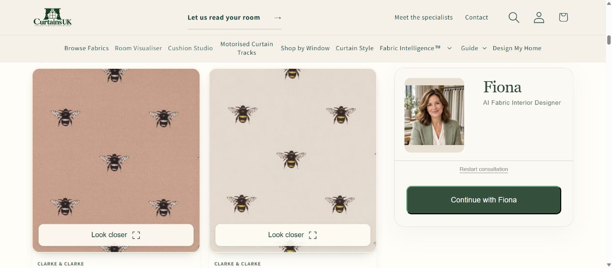
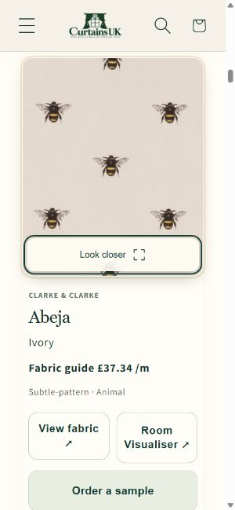

# Floating swatch review

Base: protected `release/production` at `5469cd3447ffef14c1f38e673cd3ed06ac3681ef`.

Browse cards have a slight whole-card shadow, warm ivory edging around the fabric photograph, and a translucent Look closer panel with an inline expand icon. Only the image face moves: a 3 px lift and at most 1.6 degrees of mouse tilt, or a 2 px press response. The existing photograph, crop, colour, texture, pricing and destinations are retained. Keyboard focus and an open close-up strengthen the edge treatment. Browse has no saved/compare toggle, so this change does not imply a new saved state.

## Loading and interaction cost

The change adds 1,344 gzip bytes across the two existing Browse assets: 1,011 bytes of JavaScript and 333 bytes of CSS, measured against the protected base using Node gzip. It introduces no libraries, model files, images, external assets or catalogue calls. Existing image URLs, responsive sizes and lazy loading remain intact; the larger close-up still loads on request.

One delegated pointer handler serves the grid. It is enabled only for a fine mouse pointer with hover and no reduced-motion preference. A burst of pointer events schedules at most one animation frame; no frame reschedules itself. The stationary image bounds are measured on entry, and scrolling, resizing, pointer exit, presses, blur, re-rendering and motion-preference changes reset the active swatch. Only the active image receives `will-change`. Shadows are static; motion changes transform and edge opacity. The image receives no tint, filter or shine overlay.

## Verification

- Six existing filter-selection and compact-card checks passed, retaining rapid removal/reset behaviour and card identities and destinations.
- A local motion lifecycle check passed: no pointer handler in the disabled state, no work at load or on touch input, 100 pointer events coalesced into one frame and one bounds read, bounded tilt, no idle animation loop, and cleanup on scroll, catalogue re-render and reduced-motion changes.
- JavaScript syntax, Shopify validation for both changed assets, and the 576-file composed source manifest passed.
- The existing captured-catalogue preview rendered all 24 cards. Desktop and a 390 px browser viewport had readable controls; the phone content width was 375 px after the browser scrollbar, with no horizontal overflow and 44 px Look closer targets.
- The close-up opened, Escape closed it, focus returned to its original button, and the active-preview state cleared. Browser inspection showed the photographs still loaded lazily with opacity 1, no filter and no image transform. No browser errors or warnings were recorded.

The preview used captured public catalogue data and injected response latency. These checks establish the bounded asset and interaction cost, not a new production load-time benchmark or a physical phone test. No existing protected tests or release policy were changed.

## Publication

The owner authorised publication with “Let’s deploy” and reiterated that no existing feature should be switched off. [PR #252](https://github.com/Nylon1/CurtainsUK/pull/252) passed both required checks at `ebab9bb5ee106db8ca24b2abdc0b25e637339f20`, then merged at protected `4951de05b3f25c17c4f461dd14332679338d8add` (tree `524e6b0344952a4675a713ef746b72786b043e54`). The composed export from that exact protected HEAD supplied only `assets/curtainsuk-browse-filters.css` and `assets/curtainsuk-browse-filters.js` to existing MAIN theme `182339731835`, using a scoped upload with deletion disabled.

Fresh full Shopify pulls matched all 576 files to protected source before and after the upload. The two expected asset digests are the only manifest differences. `config/settings_data.json` remained byte-identical, SHA-256 `3BB8BC0C780E34939031EE83BCA41584CF973018A8EAAAC112B1027D7F45E502`. The full pre-release backup and publication receipt are retained in `C:\Users\hamza\curtainsuk-floating-swatch-release-20261020`; rollback for this release is a scoped upload of those two previous assets, followed by readback.

Live Chrome verification:

- 24 cards and 24 swatch faces rendered with the new static card shadow. Existing image URLs still load lazily, with opacity 1 and no image filter. Look closer targets remained 44 px high.
- Beige/Taupe returned 774 fabrics; adding £30–under £60 returned 401; Clear all restored 11,815. Existing loading feedback remained visible while the catalogue refreshed.
- Abeja Ivory's close-up opened on desktop and the narrow viewport. Escape closed it, returned keyboard focus to the trigger and cleared the active-preview state.
- The available Ivory card retained View fabric, Room Visualiser, Order a sample, Make curtains and fabric-specific Jane entry. The Blush card retained its existing supplier-stock restriction; this was not a feature switch.
- Fiona loaded “What matters most from your curtains?” with all four answers, and Browse on my own returned to filtering.
- Desktop content width was 1,216 CSS px. The 390 px outer browser viewport rendered at 300 CSS px with the browser's existing zoom. Neither layout overflowed horizontally.
- Captured warnings/errors came from installed browser extensions accessing sandboxed storage; no Browse application error was observed.

This was bounded verification of the two-asset visual release. The broader sample, curtain, Room Visualiser, adviser, Fabric Intelligence, Cushion Studio, Smart Track Studio and Design My Home checks remain recorded in the earlier 20 October publication. No payment, signed-in adviser response, physical phone test or new production speed benchmark was repeated. Vercel, Supabase, pricing and all feature/environment settings were unchanged.

